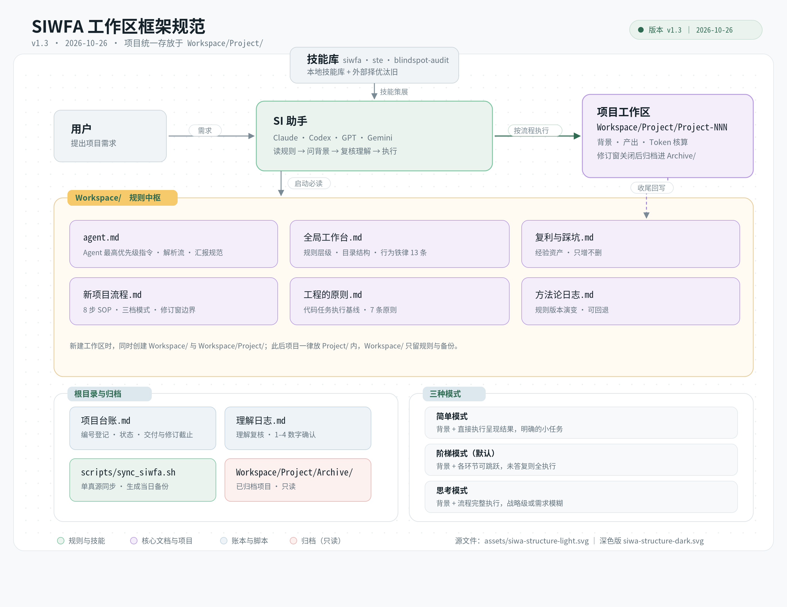

<h1 align="center">SIWFA</h1>
<p align="center">（SI Workspace Framework Agent 工作区框架规范）</p>
<p align="center"><b>v1.3 · 2026-10-26</b> — 项目目录统一归入 <code>Workspace/Project/</code></p>


> **六份文档，把任何 SI 助手变成「有规矩」的工作搭档。**
>
> 一套文件夹规范 + 一套项目流程 + 一条汇报标准 + 两份账本，开箱即用。
> 适用于 Claude、Codex、GPT、Gemini 等任何能读取文件的 SI Agent（智能体）。

---

## 🎯 它解决什么问题

| 没有框架时 | 有了框架后 |
|---|---|
| 文档散落各处，找不到上次的产出 | 所有产出强制归入 `Project-NNN-名称/` |
| Agent 不读规则就动手，方向偏航 | Agent 启动前必须先读三份核心文档 |
| 同样的坑反复踩，经验不沉淀 | 每个项目收尾强制沉淀到「复利与踩坑」 |
| 汇报啰嗦、抓不住重点 | 汇报统一遵循 STE 规范：关键信息先行、状态词固定 |
| 成本不可见 | 每个项目收尾做 Token 成本核算 |
| 交付没有边界 | 先出预览再出完整版，交付后 48 小时免费修订 |
| 多会话撞项目编号 | `项目台账.md` 统一登记编号，编号不复用 |
| Agent 理解偏差无人发现 | `理解日志.md` 用数字选项复核理解，确认后才执行 |
| 规则互相冲突，不知先听谁 | 六级规则层级：同级取更严，无法判定就提问 |
| 项目堆满根目录 | 收尾后归档进 `Archive/`，档案只读 |

## 🏗️ 框架长什么样

<picture>
  <source media="(prefers-color-scheme: dark)" srcset="assets/siwa-structure-dark.png">
  
</picture>

```
<WORKSPACE_ROOT>/　　　　← 你自选的工作区根目录（如 ~/work）
├── Workspace/　　　　   ← 规则中枢（六份核心文档 + 备份，不存项目产出）
│   ├── agent.md　　　　 ← Agent 最高优先级指令
│   ├── 全局工作台.md　　 ← 总体规则、行为铁律（13 条）、命名规范、规则层级
│   ├── 复利与踩坑.md　　 ← 经验资产库，只增不删
│   ├── 新项目流程.md　　 ← 项目执行 SOP，三档模式
│   ├── 工程的原则.md　　 ← 代码/工程任务执行基线
│   ├── 方法论日志.md　　 ← 规则版本演变，可回退
│   │
│   └── Project/　　　　 ← 全部项目与归档（项目唯一存放位置）
│       ├── Project-001-名称/
│       │   ├── 背景情况.md　　　 ← 必填，按模板八项填写
│       │   ├── Token成本核算.md ← 项目收尾统计
│       │   └── ...　　　　　　　 ← 该项目全部产出
│       ├── Project-002-名称/
│       └── Archive/　　　　　　 ← 已归档项目，只读
│
├── 项目台账.md　　　　  ← 编号登记 + 项目状态总表
├── 理解日志.md　　　　  ← 需求理解复核记录（数字选项确认）
└── scripts/　　　　　　 ← sync_siwfa.py 副本同步与备份
```

## 🚀 三步接入

**第一步：确定工作区位置** — 选定（或创建）你的工作区根目录 `<WORKSPACE_ROOT>`（如 `~/work`），并在其下**同时创建两个目录**：`Workspace/` 与 `Workspace/Project/`。此后所有项目一律建在 `Workspace/Project/` 内。

**第二步：放置文档并安装技能** — 把本仓库 `workspace/` 目录下的六份核心文档放入 `<WORKSPACE_ROOT>/Workspace/`；安装三个技能：`siwfa`（本框架）、`ste`（STE 汇报规范）、`blindspot-audit`（盲点扫描）。缺少后两个时，框架会按内置降级规则执行。

**第三步：执行文档，发送启动提示词** — 把下面这段提示词发给你的 SI 助手（触发它读取文档并进入工作模式），其中的 `<WORKSPACE_ROOT>` 要替换成第一步确定的实际路径：

```
你是我的工作助手。启动任何任务前，先读取 <WORKSPACE_ROOT>/Workspace/ 下的六份核心文档：
agent.md、全局工作台.md、复利与踩坑.md、新项目流程.md、工程的原则.md、方法论日志.md。
同时读取 <WORKSPACE_ROOT>/项目台账.md 与 <WORKSPACE_ROOT>/理解日志.md。
确认理解后，按「新项目流程」执行，向我的汇报遵循 STE 规范。
```

## 🧩 作为 Skill 使用

本框架也提供 **skill 版**（[`skill/siwfa/`](skill/siwfa/)），可直接安装到支持 Skill 机制的 SI 助手（Claude Code、Codex、Hermes 等）——助手会在「建立工作系统／初始化工作区」类请求时自动触发：

- `SKILL.md`：框架入口（核心契约速览 + 工作区初始化指引）
- `references/`：六份核心文档原文（运行时模板，与 `workspace/` 保持同步）

**安装**：把 `skill/siwfa/` 整个目录复制进你的助手技能目录即可（如 `~/.hermes/skills/<分类>/siwfa/`）。

## 📚 六份核心文档

| 文档 | 职责 |
|------|------|
| [`agent.md`](workspace/agent.md) | Agent 最高优先级指令：解析流、第一动作、汇报规范 |
| [`全局工作台.md`](workspace/全局工作台.md) | 规则层级、目录规范、行为铁律（13 条）、两份账本、命名规范、执行原则（9 条）、归档与副本同步 |
| [`复利与踩坑.md`](workspace/复利与踩坑.md) | 记录错误、教训、可复用方法，避免重复踩坑 |
| [`新项目流程.md`](workspace/新项目流程.md) | 项目 SOP：三档模式 + 8 步流程 + 背景模板 + 修订窗边界 + 内置盲点清单 |
| [`工程的原则.md`](workspace/工程的原则.md) | 代码/工程任务执行基线（7 条原则） |
| [`方法论日志.md`](workspace/方法论日志.md) | 方法论的版本演变记录 |

## ⚙️ 三种执行模式

每个项目启动前先选模式，按复杂度匹配投入：

| 模式 | 定义 | 适用场景 |
|------|------|----------|
| 简单模式 | 背景 + 直接执行呈现结果 | 需求明确的小任务：改个文件、写段文案、查个信息，问清背景后直接出结果 |
| 阶梯模式（默认） | 背景 + 各环节可跳跃 | 中等复杂度的项目：框架提问、盲点扫描、方案推演各环节可由用户决定跳过，节奏灵活 |
| 思考模式 | 背景 + 流程完整执行 | 战略级或需求模糊的项目：完整走完提问、盲点推演、方案制定，再动手执行 |

## ✨ 特色机制

- **STE 汇报规范**：源自 `ste` 技能（ASD-STE100 简化技术中文，MIT），汇报关键信息先行、状态词固定、如实写验证，不叙述过程；无该技能时按降级写法执行。
- **盲点三维扫描**：关键节点用 `blindspot-audit` 扫盲区，给 3 种解决方向；无该技能时按内置六问清单执行。
- **技能策展**：项目启动前检索本地技能库 → 对比外部平台 → 择优汰旧，结果写进背景情况。
- **Token 成本核算**：项目收尾记录预估与实际消耗，成本可见。
- **交付后修订窗口**：交付后 48 小时内免费修订一轮。一轮 = 一次集中修订、改动不超过交付物 30%、不改变已确认的范围。
- **双账本**：`项目台账.md` 管编号与状态，`理解日志.md` 管理解与确认。
- **规则层级**：六级优先级，同级冲突取更严，无法判定就提问并记入方法论日志。
- **方法论日志**：任何规则改动都记录版本，支持对比与复原。
- **单真源同步**：工作区为唯一真源，`scripts/sync_siwfa.py` 推送到公开副本并生成带日期备份；个人内容用 `personal` 标记隔离，不进公开仓库。

## ❓ FAQ

**支持哪些 Agent？**
任何能读取文件的 SI 助手（Claude、Codex、GPT、Gemini、DeepSeek 等）。有 skill 机制的（如 Claude Code、Hermes），额外安装 `siwfa`、`ste`、`blindspot-audit` 三个技能即可；没有的，按文档内写明的降级步骤执行。

**必须用中文吗？**
框架本身为中文设计，规则与语言无关，你可以按需翻译。

**每次会话会忘掉规则怎么办？**
框架的设计就是「文件即记忆」：Agent 每次启动先读文档，规则写在文件里而不是会话里，天然跨会话、跨 Agent。

**和 Agent 的官方 memory（记忆）功能冲突吗？**
不冲突。官方 memory 适合存用户偏好，本框架负责工作流纪律，两者互补。

**我改了自己的文档，仓库副本会跟着变吗？**
不会自动变。你在工作区改完后，运行 `python3 scripts/sync_siwfa.py`，脚本会把公开副本更新并生成当日备份。`--check` 参数只比对不写入。

## 🙏 致谢

- 感谢 dualface 开发的 [ste-zh](https://github.com/dualface/ste-zh)（ASD-STE100 简化技术中文，MIT 许可）——本框架的 STE 汇报规范来源。
- 感谢 MJL-ren 开发的 [blindspot-audit](https://github.com/MJL-ren/blindspot-audit)——本框架的盲点扫描方法来源。

## 📄 License

[MIT](LICENSE)

---

*本框架由实际工作迭代而来，欢迎 Star、Fork、提 Issue 一起改进。*
